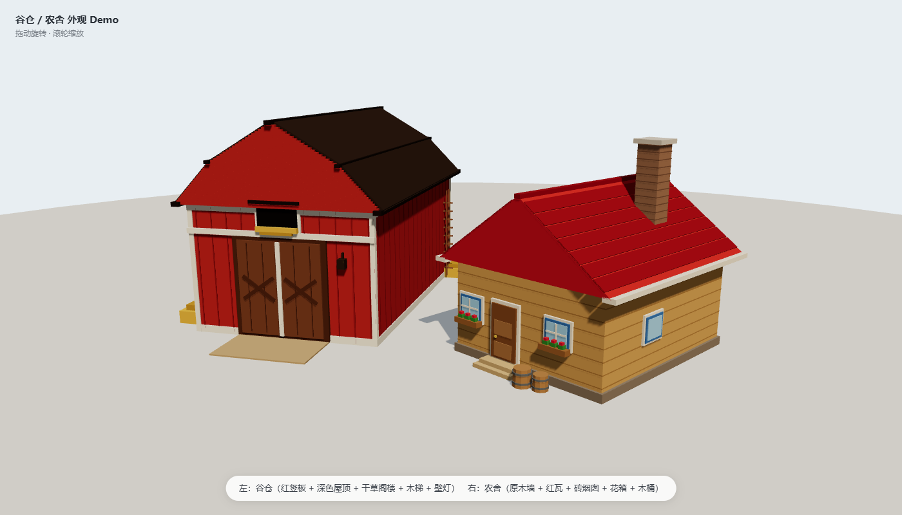
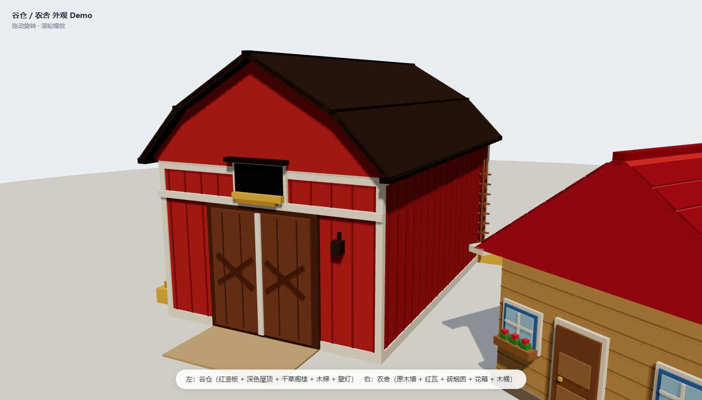
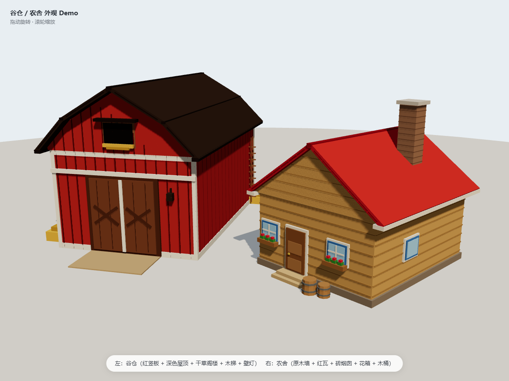
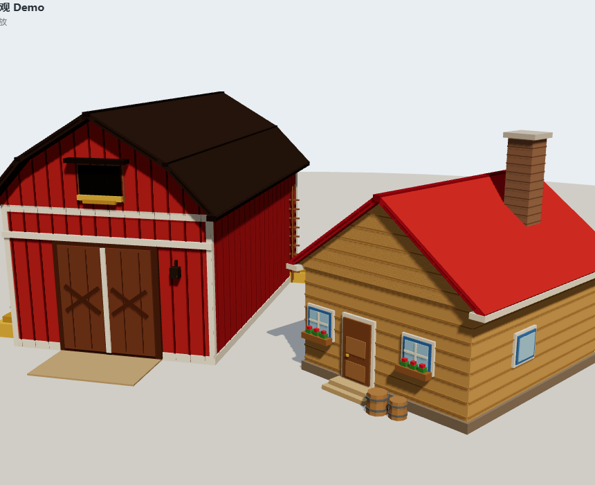

# Meadowland · 低多边形农场

**版本 0.5.0**

一个治愈系低多边形 3D 农场场景。基于 **three.js r169** 从零重写，参考 [Windland](https://windland-neotix.vercel.app/) 的氛围与叙事结构，所有模型与材质全部程序化生成，不依赖任何外部资产。

---

## 预览

| 全景 | 谷仓 | 农舍 |
| --- | --- | --- |
|  |  |  |



---

## 快速开始

### 方式 A：直接双击（无需任何环境）

打开 `standalone/index.html` 即可。它是把 three.js 与背景音乐全部内嵌的单文件版本，断网也能运行，方便直接分享。

### 方式 B：本地服务器（开发调试）

```bash
cd meadowland
node serve.mjs
```

浏览器打开终端打印的地址（默认 `http://127.0.0.1:5173`）。手机与电脑连同一 Wi-Fi 时，也可以用终端打印的局域网地址访问。

### 方式 C：在线体验

<https://Cl0ud-99.github.io/meadowland/>

---

## 玩法与交互

- **拖动**旋转视角，**滚轮**缩放，**WASD** 平移，**空格 / Ctrl** 升降，**Shift** 加速。
- **点击**建筑、田地、树木、动物、雪人等对象进行特写。
- 底部滑杆可平滑切换**时间**（清晨↔夜晚）与**季节**（春↔夏↔秋↔冬）。
- 各类建筑、作物、树木、围栏、卡车、雪人均可**单独换装**，所有选择都会被记住。
- 右侧骰子按钮可切换到**随机角色的第一人称视角**。

---

## 构建与打包

```bash
npm install        # 或 pnpm install
node prepare.mjs   # src -> site
node bundle.mjs    # site -> standalone
```

依赖仅 `three@0.169` 与 `vite@5`，无平台相关代码。

---

## 项目结构

```text
src/          源码
site/         分离版（本地服务器运行）
standalone/   单文件版（双击即玩）
```

---

## 许可

MIT
