# Meadowland · 低多边形农场

**by DeepSeek-three.js r169**

**DSH-PTC**

可互动像素农场**版本 0.7.8** · [在线体验](https://Cl0ud-99.github.io/meadowland/?v=0.7.8)


---

## 关于这个场景

Meadowland 想做的不是“又一个农场模拟器”，而是一块可以随时走进去发呆的地方。

清晨的薄雾、午后的云影、傍晚的炊烟、冬天的第一场雪——时间与季节在底部滑杆上缓慢流动，农场里的动物、人物和树木各自按自己的节奏生活。你可以拖动视角四处看看，也可以点开一座谷仓、一棵树、一口水井或一个雪人，给它换一种样子。

开屏不再直接落在农场中央：镜头会从世界边界的三处山脊中随机抽一处，前景是山坡和松林，农场在远处山谷里。点击屏幕后，镜头再慢慢飞进场景。

没有任务，没有倒计时，也没有失败。

---

## 版本亮点

- **三处随机山脊开屏**：西侧、西北、东南边界各一个机位，前景松林/山坡遮挡，点击后飞入农场。
- **开屏随机时间 / 四季**：早 / 中 / 晚 × 春 / 夏 / 秋 / 冬随机；开屏时间和季节优先于默认快照。
- **修理棚工作区**：木架、金属单坡顶、工作台、台钳、工具墙、工具柜、木箱、油桶、轮胎、锯木架和 WORKSHOP 牌子。
- **修理棚特写 + 四套配色**：点击棚子进入特写，配色面板用色块切换原木、森林绿、工业蓝、暖沙色。
- **水井特写 + 四套配色**：石砌木井、红砖井、青石井、白灰井；井石、木架、屋顶和井水一起换色。
- **接触阴影**：建筑、树根、围栏脚边都有贴地暗斑，草簇根部也压暗。
- **草地层次**：中频草色团块、坡度和低洼烘焙阴影、整体明度下调 30%，让地面不再像一张纸。
- **太阳本体亮度**：核心亮度降低 30%，只压日盘，不改变全局光照。
- **太阳轨迹**：早晨东侧、正午最高、傍晚西侧的东升西落弧线；核心亮度保持降低 30%。
- **开屏待机视差**：开屏未点击时保留低振幅鼠标视差，但只移动相机、不跑 OrbitControls，不再抖动/撕裂。

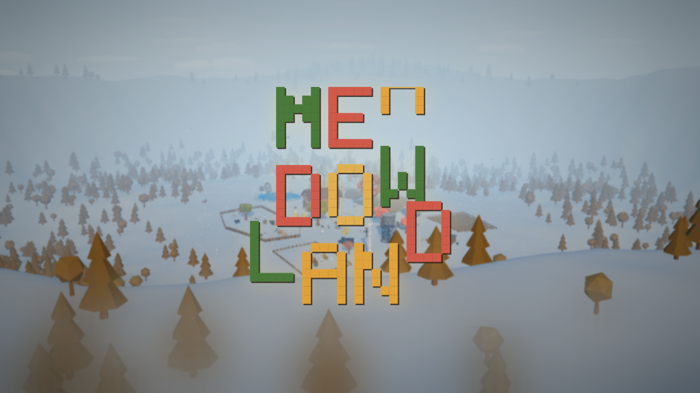

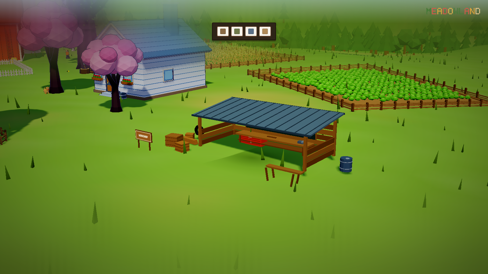

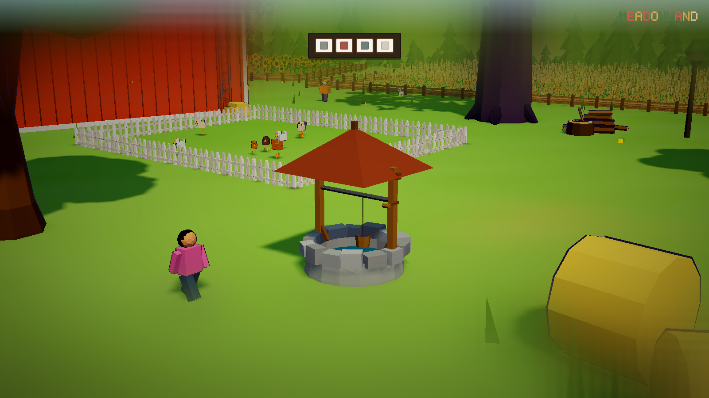

---

## 预览

| 清晨全景 | 冬日雪景 |
| --- | --- |
|  | 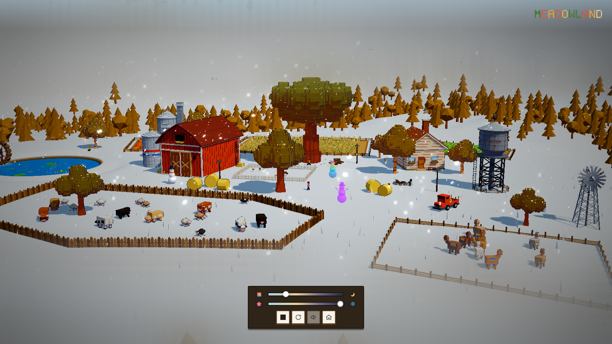 |

| 黄昏 | 水车 |
| --- | --- |
| 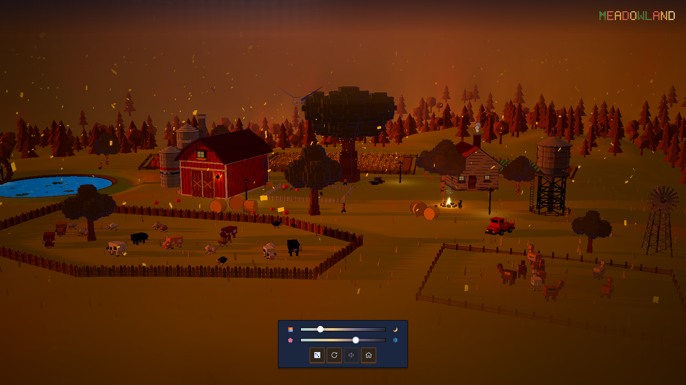 | 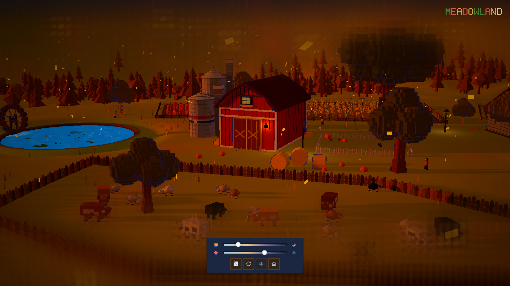 |


---

## 互动

点击场景里的建筑、动物、雪人、修理棚、水井，进入特写并更换样式或配色。

| 建筑换色 | 雪人独立换装 |
| --- | --- |
| 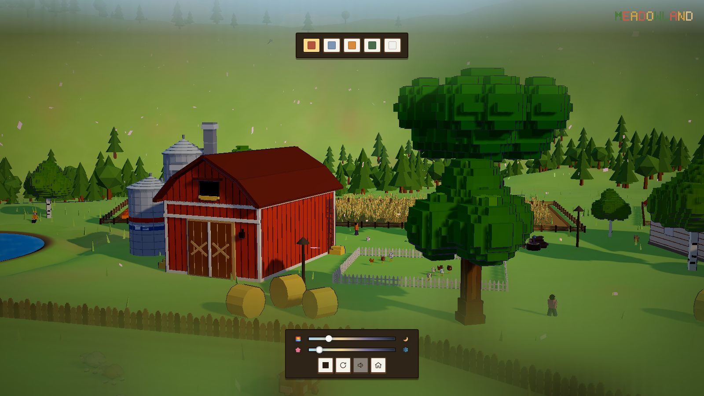 | 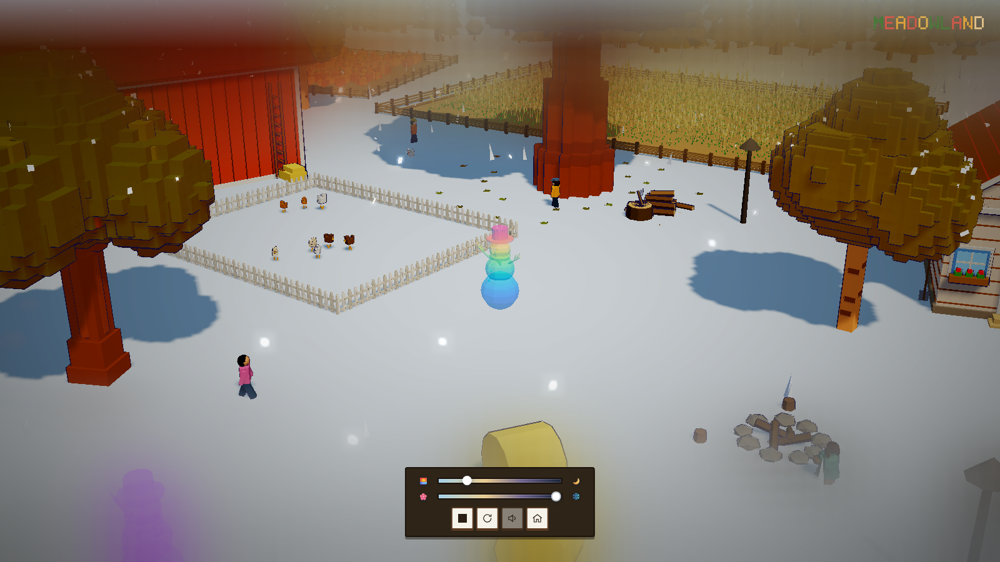 |

| 动物特写 | 第一人称 |
| --- | --- |
| 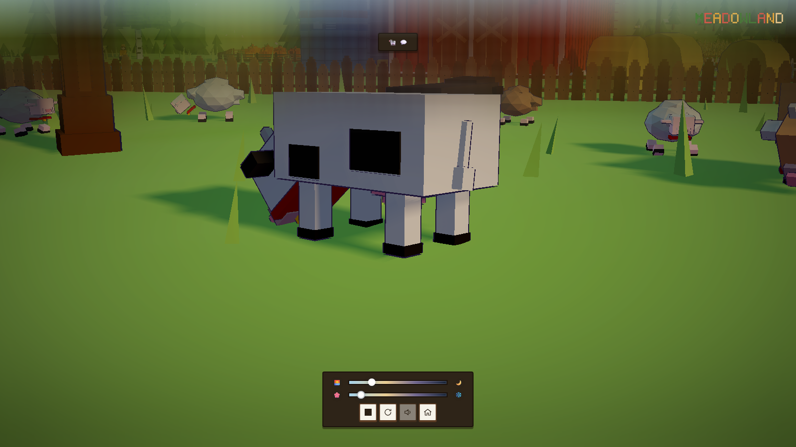 | 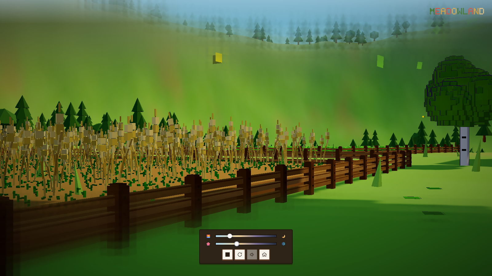 |

| 夜晚灯光 | 农田近景 |
| --- | --- |
| 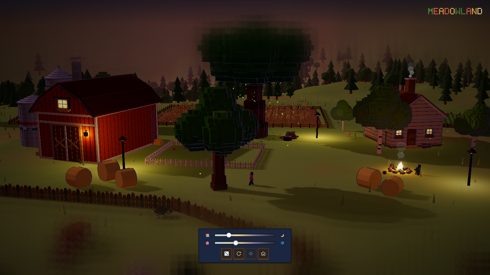 | 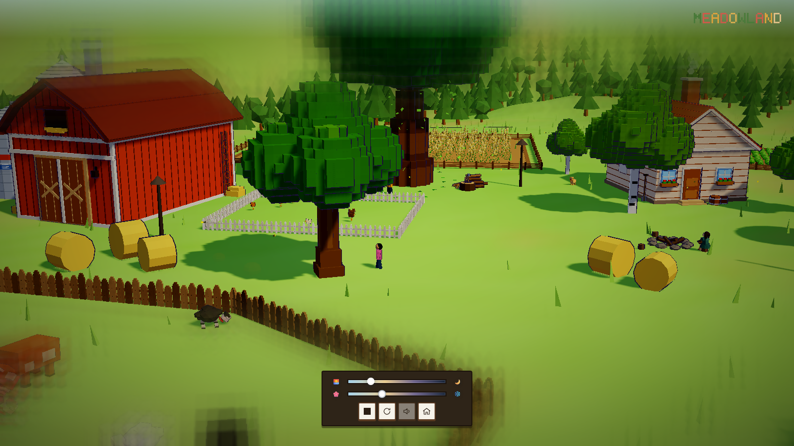 |

---

## 快速开始

### 直接双击（无需环境）

打开 `standalone/index.html`。three.js 与背景音乐全部内嵌在这个单文件里，断网也能运行。

### 本地服务器（开发调试）

```bash
cd meadowland
node scripts/serve.mjs
```

浏览器打开终端打印的地址（默认 `http://127.0.0.1:5173`）。手机与电脑连同一 Wi-Fi 时，也可以用局域网地址访问。

### 在线体验

<https://Cl0ud-99.github.io/meadowland/?v=0.7.8>

---

## 交互

- **拖动**旋转视角，**滚轮**缩放，**WASD** 平移，**空格 / Ctrl** 升降，**Shift** 加速。
- **点击**建筑、田地、树木、动物、雪人、修理棚、水井，进入特写并更换样式或配色。
- 底部滑杆切换**时间**与**季节**，所有元素会平滑过渡。
- 右侧骰子按钮切换到**随机角色的第一人称视角**。
- 所有自定义都会保存在本地，下次打开自动恢复。
- 每次刷新页面，开屏会随机山脊机位、早/中/晚时间和春/夏/秋/冬季节。
- 进入场景后保持本次随机时间与季节；默认快照负责其余状态，时间和季节由开屏时间线优先决定。

---

## 构建与打包

```bash
npm install        # 或 pnpm install
node scripts/prepare.mjs   # src -> site
node scripts/bundle.mjs    # site -> standalone
```

依赖仅 `three@0.169` 与 `vite@5`，无平台相关代码。

---

## 项目结构

```text
src/          源码
site/         分离版（本地服务器运行）
standalone/   单文件版（双击即玩）
screenshots/  预览截图
scripts/      构建、自检、本地服务器等开发脚本
dev/demos/    旧版模型 demo（保留备查）
```

---

## 许可

MIT
