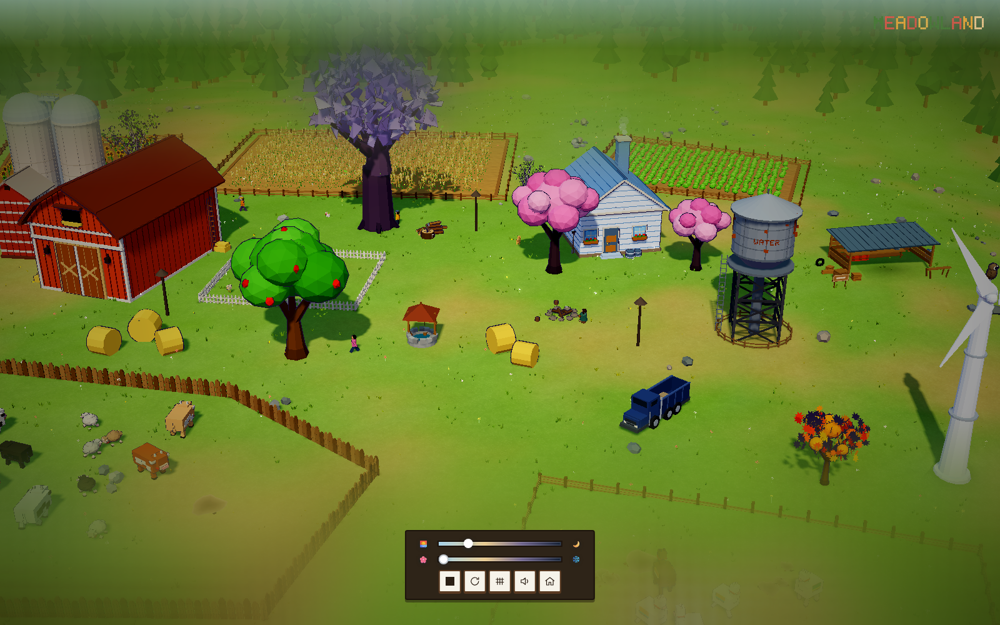
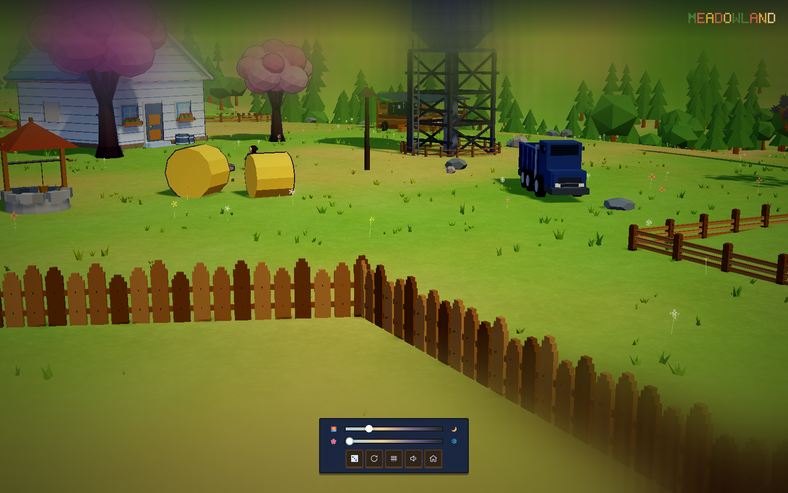
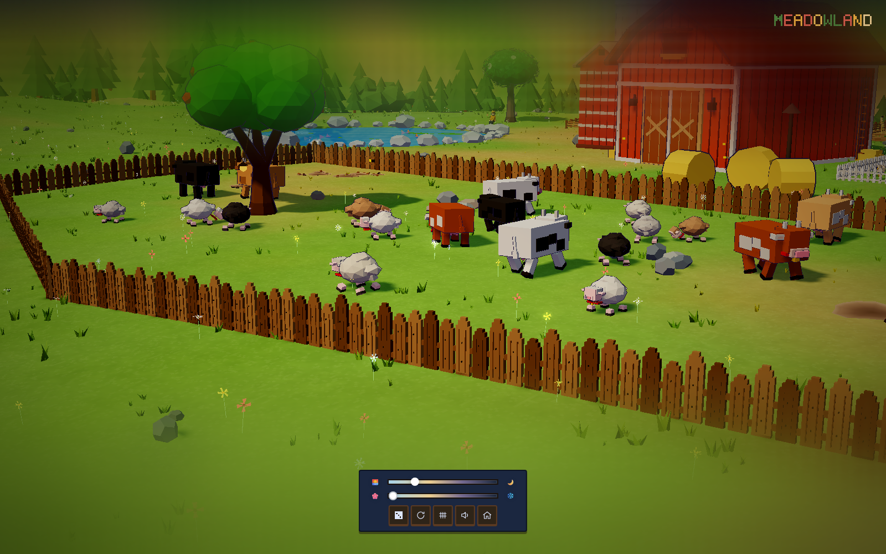
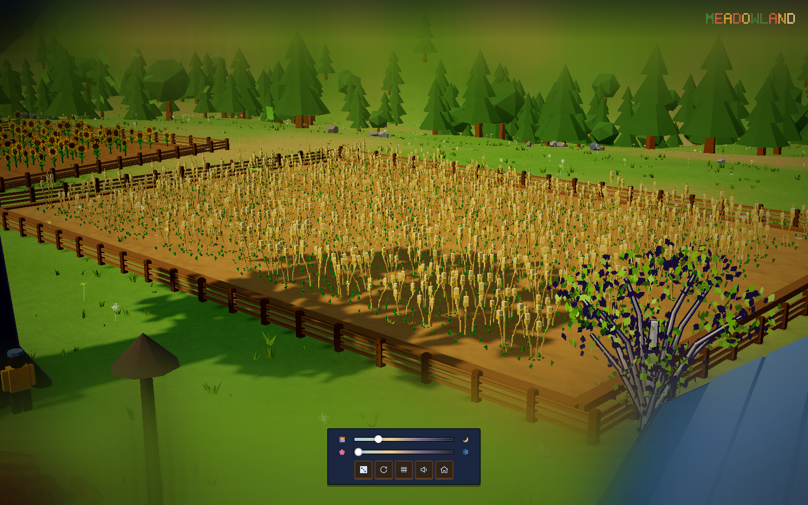
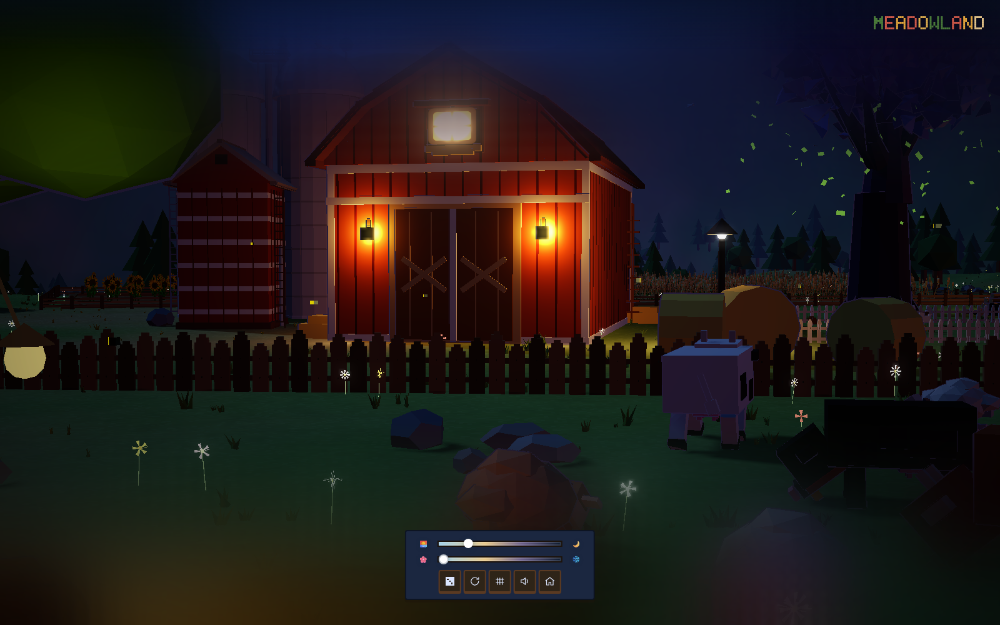
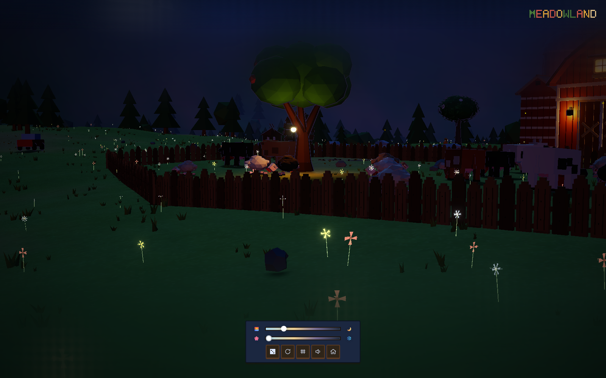
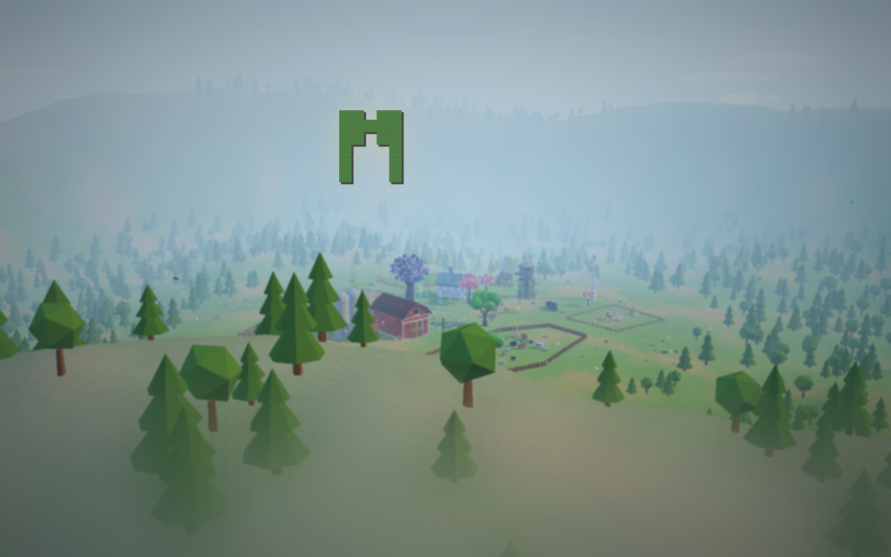

# Meadowland · 毛毡草地低多边形农场

**by DeepSeek-three.js r169 · DSH-PTC**

可互动低多边形农场 **正式版 0.8.0** · [在线体验](https://Cl0ud-99.github.io/meadowland/?v=0.8.0)



---

## 0.8.0 正式版 · 把农场做得更柔软

这一版没有继续往场景里堆建筑，而是把农场最基础、也最容易被忽略的部分重新做了一遍：地面、草、花、石头、土壤，以及动物和作物的运动。

草地不再是一张绿色平面，而是带世界空间毛毡颗粒、远近层次和独立风摆的整片地表；草丛从农场中心一直铺到外圈山坡，中间夹着稀疏的野花、散落的石头和动物刨出的土坑。黄土地上的草会变稀、变黄、变矮，牛羊和羊驼也不再顶着障碍走很久才掉头。

白天可以看风吹过麦田，傍晚谷仓两侧的壁灯和牧场树上的吊灯逐渐亮起，夜晚的农场仍然保留着可以走进去发呆的温度。

---

## 0.8.0 更新内容

### 草地与地表
- 程序化毛毡草地：世界空间颗粒、低频草色团块和细碎高光
- 草丛覆盖半径扩大到 290，使用抖动网格均匀铺满主场景
- 草簇有独立高矮、宽窄、冷暖色差和风摆相位
- 黄土地草密度减半，同时发黄、枯萎、压矮
- 五种小花：白雏菊、黄金凤、红虞美人、蓝矢车菊、粉花
- 小花高于草面，和草使用同一距离淡出；进入游玩后默认开启音乐

### 石头与动物
- 地面散石：单块、成对、3~6 块成群
- 大石头有体积碰撞，动物、人物和宠物都会绕开
- 动物改为提前探测围栏、树和石头，立即转弯而不是顶着障碍走
- 牛羊圈树木挂上吊灯，夜间照亮树下；换树种后挂点自动适配
- 羊驼数量调整为 7 只

### 农田与土壤
- 土壤重新细分，加入真实小起伏和程序化土粒纹理
- 作物不再远距离淡出，和动物保持一致可见
- 作物加入独立随机风摆
- 动物圈加入刨土坑，鸡舍土坑尺寸更小

### 夜间与交互
- 谷仓左右壁灯对称，各带灯泡、地面光斑和点光源
- 开屏随机山脊、随机时间与季节
- 点击建筑、树木、动物、水井、修理棚等仍可进入特写和换装
- 第一人称、季节滑杆、时间滑杆和本地存档保留

---

## 预览

| 毛毡草地 | 牧场与散石 |
| --- | --- |
|  |  |

| 农田与风摆 | 夜间灯光 |
| --- | --- |
|  |  |

| 树上吊灯 | 开屏 |
| --- | --- |
|  |  |

---

## 互动

- **拖动**旋转视角，**滚轮**缩放，**WASD** 平移，**空格 / Ctrl** 升降，**Shift** 加速。
- **点击**建筑、田地、树木、动物、雪人、修理棚、水井，进入特写并更换样式或配色。
- 底部滑杆切换**时间**与**季节**，所有元素会平滑过渡。
- 右侧骰子按钮切换到**随机角色的第一人称视角**。
- 所有自定义都会保存在本地，下次打开自动恢复。
- 每次刷新页面，开屏会随机山脊机位、早/中/晚时间和春/夏/秋/冬季节。

---

## 快速开始

### 直接双击（无需环境）

打开 `standalone/index.html`。three.js 与背景音乐全部内嵌在这个单文件里，断网也能运行。

### 本地服务器（开发调试）

```bash
cd meadowland
node scripts/serve.mjs
```

浏览器打开终端打印的地址（默认 `http://127.0.0.1:5173`）。手机与电脑连同一 Wi-Fi 时，也可以用局域网地址访问。

### 在线体验

<https://Cl0ud-99.github.io/meadowland/?v=0.8.0>

---

## 构建与打包

```bash
npm install        # 或 pnpm install
node scripts/prepare.mjs   # src -> site
node scripts/bundle.mjs    # site -> standalone
```

依赖仅 `three@0.169` 与 `vite@5`，无平台相关代码。

---

## 项目结构

```text
src/          源码
site/         分离版（本地服务器运行）
standalone/   单文件版（双击即玩）
screenshots/  预览截图
scripts/      构建、自检、本地服务器等开发脚本
dev/demos/    旧版模型 demo（保留备查）
```

---

## 许可

MIT
