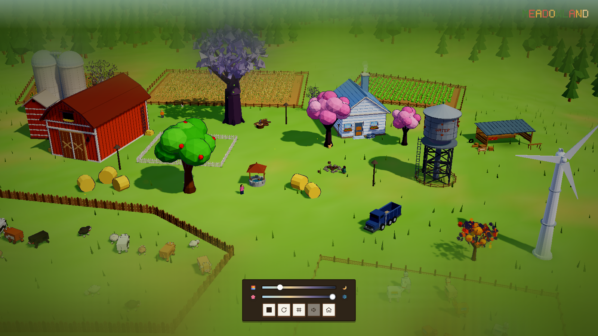

# Meadowland · 低多边形农场

**by DeepSeek-V4.1flash-1017🐳**

**DSH-PTC**

**版本 0.5.0** · [在线体验](https://Cl0ud-99.github.io/meadowland/)

可互动像素农场。基于 **three.js r169** 



---

## 关于这个场景

Meadowland 想做的不是“又一个农场模拟器”，而是一块可以随时走进去发呆的地方。

清晨的薄雾、午后的云影、傍晚的炊烟、冬天的第一场雪——时间与季节在底部滑杆上缓慢流动，农场里的动物、人物和树木各自按自己的节奏生活。你可以拖动视角四处看看，也可以点开一座谷仓、一棵树或一个雪人，给它换一种样子。

没有任务，没有倒计时，也没有失败。

---

## 预览

| 清晨全景 | 冬日雪景 |
| --- | --- |
|  |  |

| 黄昏 | 水车 |
| --- | --- |
|  |  |


---

## 互动

点击场景里的建筑、动物、雪人，进入特写并更换样式。

| 建筑换色 | 雪人独立换装 |
| --- | --- |
|  |  |

| 动物特写 | 第一人称 |
| --- | --- |
|  |  |

| 夜晚灯光 | 农田近景 |
| --- | --- |
|  |  |

---

## 快速开始

### 直接双击（无需环境）

打开 `standalone/index.html`。three.js 与背景音乐全部内嵌在这个单文件里，断网也能运行。

### 本地服务器（开发调试）

```bash
cd meadowland
node serve.mjs
```

浏览器打开终端打印的地址（默认 `http://127.0.0.1:5173`）。手机与电脑连同一 Wi-Fi 时，也可以用局域网地址访问。

### 在线体验

<https://Cl0ud-99.github.io/meadowland/>

---

## 交互

- **拖动**旋转视角，**滚轮**缩放，**WASD** 平移，**空格 / Ctrl** 升降，**Shift** 加速。
- **点击**建筑、田地、树木、动物、雪人，进入特写并更换样式。
- 底部滑杆切换**时间**与**季节**，所有元素会平滑过渡。
- 右侧骰子按钮切换到**随机角色的第一人称视角**。
- 所有自定义都会保存在本地，下次打开自动恢复。

---

## 构建与打包

```bash
npm install        # 或 pnpm install
node prepare.mjs   # src -> site
node bundle.mjs    # site -> standalone
```

依赖仅 `three@0.169` 与 `vite@5`，无平台相关代码。

---

## 项目结构

```text
src/          源码
site/         分离版（本地服务器运行）
standalone/   单文件版（双击即玩）
screenshots/  预览截图
```

---

## 许可

MIT
